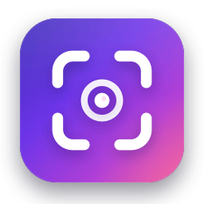
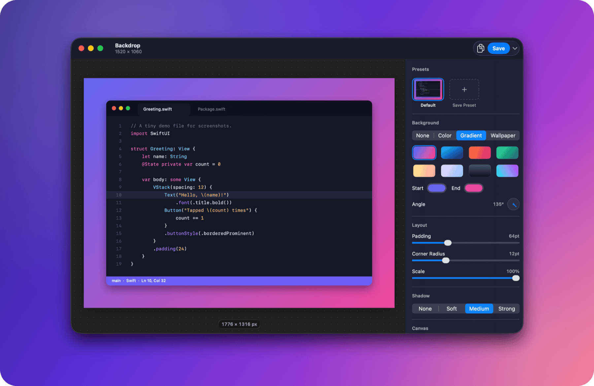
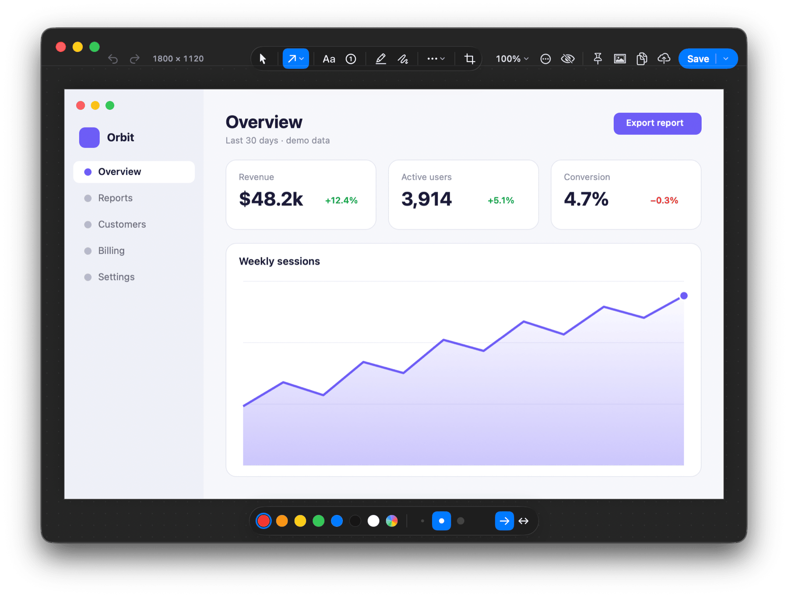
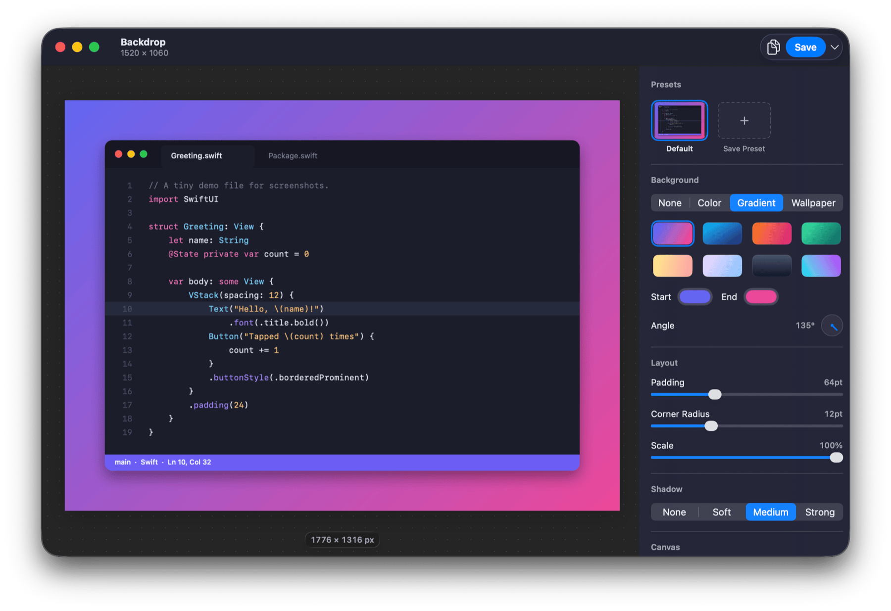
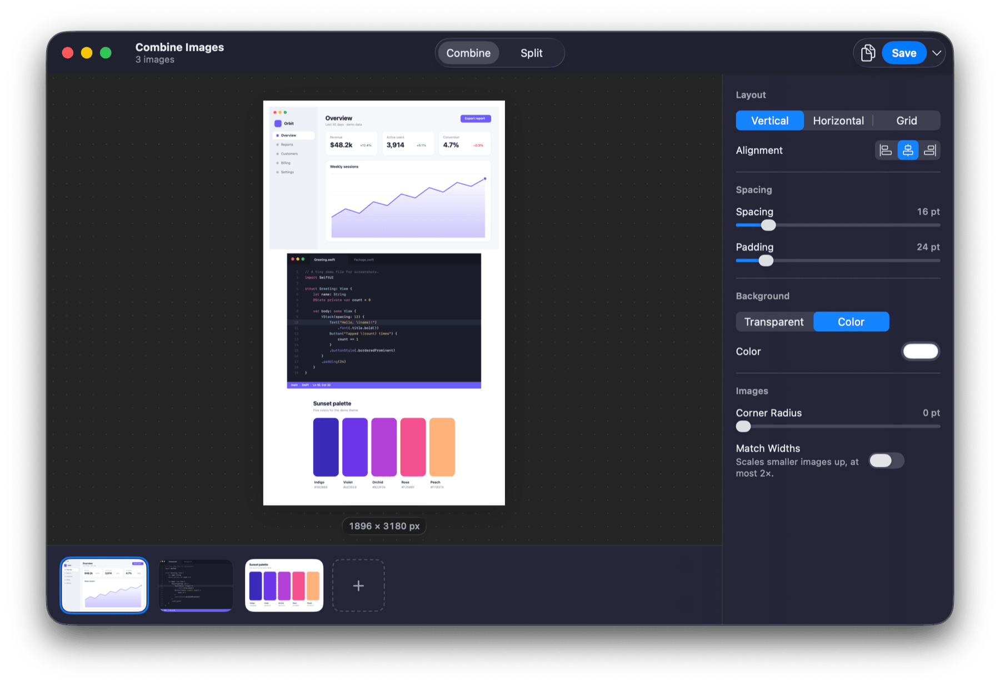
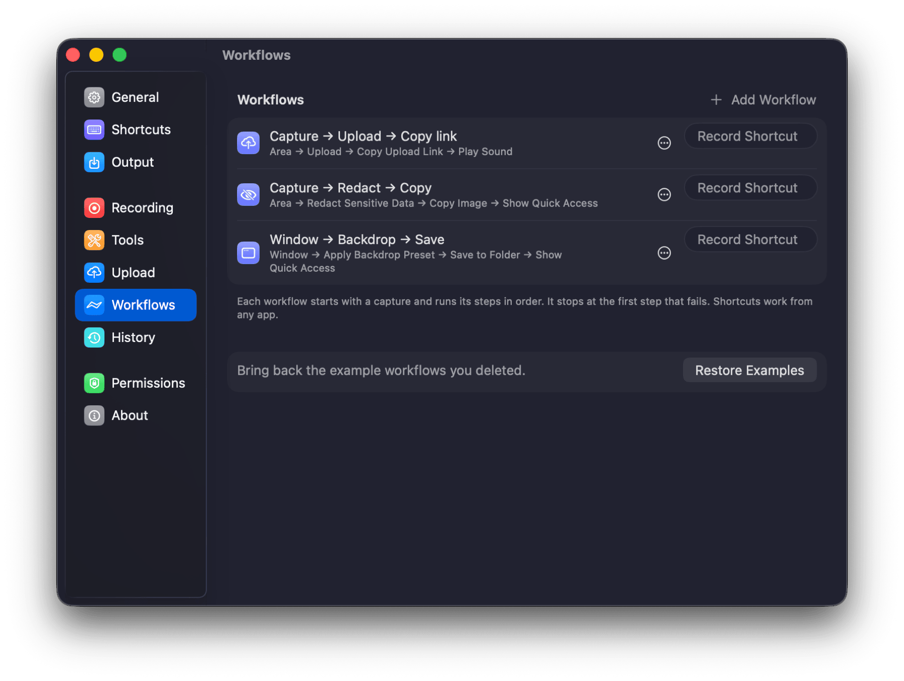
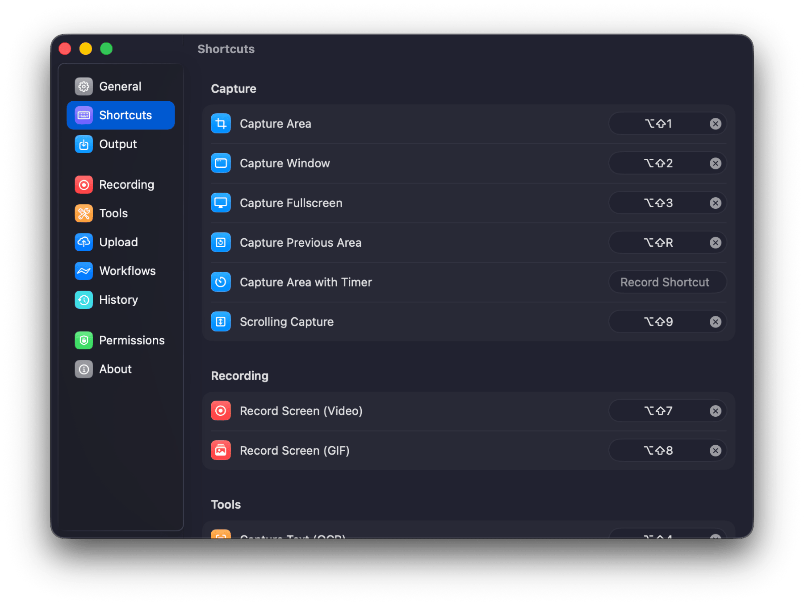
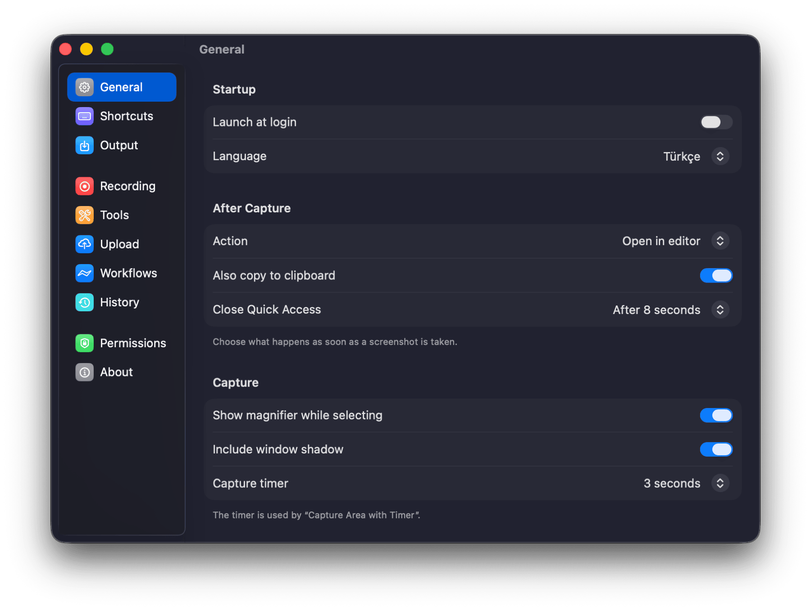

<p align="center">
  
</p>

<h1 align="center">ScreenShotForMac</h1>

<p align="center">
  <b>Capture, annotate, record and share. One native, private, open-source toolkit for macOS.</b><br>
  Screenshots, recordings, pixel tools and an annotation editor, a shortcut away.
</p>

<p align="center">
  <a href="https://github.com/atak946/ScreenShotForMac/releases/latest"></a>
  
  
  <a href="LICENSE"></a>
  <a href="https://github.com/atak946/ScreenShotForMac/actions/workflows/ci.yml"></a>
  <a href="https://github.com/atak946/ScreenShotForMac/releases"></a>
</p>

<p align="center">
  <a href="https://github.com/atak946/ScreenShotForMac/releases/latest">
    
  </a>
</p>

<p align="center">
  
</p>

<p align="center">
  <b>English</b> · <a href="README.tr.md">Türkçe</a>
</p>

---

## ✨ At a glance

ScreenShotForMac lives in the menu bar. Press a shortcut, select an area, a window or the whole screen, and
decide what happens next: copy it, save it, annotate it, pin it, upload it or run a workflow. Everything runs on
your Mac. There is no account and no telemetry.

<table>
  <tr>
    <td width="50%" valign="top">
      
      <h3>✏️ Annotation editor</h3>
      Arrows, shapes, text, highlighter, blur, pixelate, spotlight, magnifier, counters and smart erase.
      Every tool has a one-letter shortcut.
    </td>
    <td width="50%" valign="top">
      
      <h3>🎨 Backdrop</h3>
      Put any capture on a gradient, a solid color or your blurred wallpaper, with padding, rounded corners
      and a shadow. Save the look as a preset.
    </td>
  </tr>
  <tr>
    <td width="50%" valign="top">
      
      <h3>🧩 Combine and split</h3>
      Stack several images vertically, horizontally or in a grid, or cut a tall image into slices.
    </td>
    <td width="50%" valign="top">
      
      <h3>⚡ Workflows</h3>
      Chain steps after a capture: redact, add a backdrop, save, upload, copy the link, pin or open in an app.
      Give each workflow its own global shortcut.
    </td>
  </tr>
</table>

## 🧰 Features

### 📸 Capture
- Area selection with live size, coordinates and a pixel magnifier
- Window capture with hover highlight and optional window shadow, including windows behind other windows
- Fullscreen capture of the active display or all displays, with correct handling of mixed-DPI setups
- UI element snapping through the Accessibility API
- Scrolling capture that scrolls for you and stitches the frames
- Capture with a timer, and recapture of the previous area
- Frozen screen during selection, so menus and animations stay still
- An action toolbar on the selection: screenshot, record, scroll, OCR

### 🎬 Recording
- Video (MP4/MOV) and GIF recording of an area, a window or a full screen
- System audio and microphone, both optional
- Click highlighting, keystroke display, a webcam bubble and cursor visibility settings
- Pause, resume and cancel, with an elapsed time display
- Trim and mute recordings in the built-in video editor

### ✏️ Editor
- Arrows (single or double headed), lines, rectangles, ellipses, text and a pen with smoothing
- Highlighter, blur, pixelate, spotlight and magnifier callouts
- Smart erase that fills a region with the surrounding background color
- Auto-incrementing step counters and image layers
- Crop with aspect presets, rotate and flip
- Select, move, resize, reorder and copy/paste; full undo and redo
- Zoom, pan and a pixel grid

### 🔬 Tools
- Color picker with HEX, RGB, HSL, SwiftUI and NSColor output
- Pixel ruler with edge detection, plus point-to-point and area measurement
- On-device text recognition (OCR) with selectable languages
- QR code and barcode scanning
- Pinned screenshots that float above other windows, with opacity, click-through, rotation and zoom

### 📤 Sharing
- Copy to the clipboard, save as PNG, JPEG or HEIC with a quality setting
- File name templates such as `{date}_{time}_{counter}` and optional Retina-to-1x downscaling
- Drag and drop from the Quick Access preview into any app
- Uploads to S3-compatible storage (AWS S3, Cloudflare R2, MinIO, Backblaze B2) or a custom HTTP endpoint,
  with credentials kept in the Keychain
- Capture history with OCR text search and automatic cleanup

## ⌨️ Keyboard shortcuts

Default global shortcuts. You can change all of them in **Settings › Shortcuts**.

| Shortcut | Action |
|---|---|
| <kbd>⌥</kbd><kbd>⇧</kbd><kbd>1</kbd> | Capture area |
| <kbd>⌥</kbd><kbd>⇧</kbd><kbd>2</kbd> | Capture window |
| <kbd>⌥</kbd><kbd>⇧</kbd><kbd>3</kbd> | Capture fullscreen |
| <kbd>⌥</kbd><kbd>⇧</kbd><kbd>4</kbd> | Capture text (OCR) |
| <kbd>⌥</kbd><kbd>⇧</kbd><kbd>5</kbd> | Pick color |
| <kbd>⌥</kbd><kbd>⇧</kbd><kbd>6</kbd> | Scan QR code |
| <kbd>⌥</kbd><kbd>⇧</kbd><kbd>7</kbd> | Record screen (video) |
| <kbd>⌥</kbd><kbd>⇧</kbd><kbd>8</kbd> | Record screen (GIF) |
| <kbd>⌥</kbd><kbd>⇧</kbd><kbd>9</kbd> | Scrolling capture |
| <kbd>⌥</kbd><kbd>⇧</kbd><kbd>0</kbd> | Measure (pixel ruler) |
| <kbd>⌥</kbd><kbd>⇧</kbd><kbd>R</kbd> | Capture previous area |
| <kbd>⌥</kbd><kbd>⇧</kbd><kbd>V</kbd> | Open clipboard in editor |
| *(unassigned)* | Capture area with timer · Pin image from clipboard · Capture history |

The editor has its own single-key tool shortcuts: `V` select, `A` arrow, `L` line, `R` rectangle,
`O` ellipse, `T` text, `H` highlight, `B` blur, `P` pixelate, `S` spotlight, `M` magnifier,
`E` smart erase, `N` counter, `D` pen, `C` crop.

<p align="center">
  
  
</p>

## 📦 Install

1. Download the latest **ScreenShotForMac-x.y.z.dmg** from
   [Releases](https://github.com/atak946/ScreenShotForMac/releases/latest).
2. Open it and drag **ScreenShotForMac** to **Applications**.
3. Launch it. The app lives in the menu bar and has no Dock icon. A short onboarding asks for the Screen
   Recording permission.

Releases are signed with a Developer ID and notarized by Apple, so Gatekeeper accepts them. macOS only shows
its usual "downloaded from the internet" confirmation on the first launch.

**Requirements:** macOS 14 Sonoma or later, on Apple Silicon or Intel. The app is available in English and
Turkish.

### 🔐 Permissions

| Permission | Why it is needed | When it is requested |
|---|---|---|
| **Screen Recording** | Required by macOS to read screen pixels for screenshots, recordings, OCR, color picking and measuring. | On first launch, during onboarding |
| **Accessibility** | UI element snapping, automatic scrolling for scrolling capture, and click highlighting during recordings. | When you first use a feature that needs it |
| **Microphone** | Recording your voice with a screen recording. | Only when you turn on microphone recording |
| **Camera** | The webcam bubble in screen recordings. | Only when you turn on the webcam bubble |

You can review these in **System Settings › Privacy & Security** or in the app's **Settings › Permissions**.
The app is not sandboxed, because the App Sandbox blocks the Accessibility and event-tap features above.

## 🔄 Automatic updates

ScreenShotForMac checks for updates once a day with [Sparkle](https://sparkle-project.org). The update feed
and DMGs are published on this project's GitHub Releases, and every update is verified with an EdDSA
signature before it is installed. You can also choose **Check for Updates…** from the menu bar icon.

## 🤖 Automation

### URL scheme

```text
ssfm://capture?mode=area|window|fullscreen|scrolling|last&action=copy|save|edit|upload|pin&delay=N
ssfm://record?format=mp4|gif           # start or stop a recording
ssfm://workflow?name=<name>            # or ?id=<uuid>
ssfm://open?path=<file>                # open an image in the editor
ssfm://backdrop?path=<file>            # open an image in Backdrop
ssfm://combine?path=<a>&path=<b>       # open images in Combine, in this order
ssfm://ocr                             # capture text
ssfm://color                           # pick a color
ssfm://qr                              # scan a QR code
ssfm://measure                         # pixel ruler
ssfm://history                         # open the history browser
ssfm://settings                        # open Settings
```

`mode` defaults to `area`; without `action` the "after capture" setting is used. File paths must be absolute
(`~` is expanded). From a terminal: `open "ssfm://capture?mode=window&action=copy"`. The same actions are
available in Shortcuts.app.

### CLI

The `ssfm` command-line tool (`Sources/ShotCLI`) builds these URLs for you:

```sh
scripts/install-cli.sh                 # builds a release binary, installs to /usr/local/bin (uses sudo if needed)
scripts/install-cli.sh --prefix ~/bin  # or any user-writable directory, no sudo
scripts/install-cli.sh --link          # symlink to the build output instead of copying
```

```sh
ssfm capture --copy
ssfm capture window --save --delay 3
ssfm record gif
ssfm workflow "Capture → Upload → Copy link"
ssfm open ~/Desktop/shot.png
ssfm --help
```

The app must be installed (it handles the `ssfm://` URLs); the CLI only forwards commands.

<a id="build-from-source"></a>

## 🛠️ Build from source

Building needs Xcode 16 or later (Swift 6) and [XcodeGen](https://github.com/yonaskolb/XcodeGen).

```sh
brew install xcodegen

git clone https://github.com/atak946/ScreenShotForMac.git
cd ScreenShotForMac

# Signing: put your Apple Developer Team ID in a local, gitignored config
cp Config/Local.xcconfig.example Config/Local.xcconfig
# edit Config/Local.xcconfig -> DEVELOPMENT_TEAM = <your team id>

xcodegen generate
xcodebuild -project ScreenShotForMac.xcodeproj \
  -scheme ScreenShotForMac -configuration Debug \
  -derivedDataPath DerivedData build
```

To build without a signing identity (for CI or a quick compile check), add `CODE_SIGNING_ALLOWED=NO`. An
unsigned build cannot keep the Screen Recording permission between launches, so use a signed build for
day-to-day testing. The `.xcodeproj` is generated: change `project.yml`, not the project file.

The `ShotKit` Swift package builds and tests on its own with `swift build` and `swift test`.

<a id="architecture"></a>

<details>
<summary><b>Architecture</b></summary>

The app target (`App/`) is a thin shell: app delegate, menu bar, URL routing and a coordinator that connects
modules. Features live in the `ShotKit` Swift package. Every feature module depends only on `ShotCore`, and
modules talk to each other through protocols defined there.

| Module | Responsibility |
|---|---|
| `ShotCore` | Shared models, `AppCommand`, settings, logging, service protocols, design tokens |
| `ShotCapture` | Area, window and fullscreen capture, selection overlay, magnifier, element snapping |
| `ShotRecording` | Screen recording to video and GIF, audio, click highlighting, recording controls |
| `ShotScrolling` | Scrolling capture: auto-scroll, frame grabbing, offset estimation, stitching |
| `ShotEditor` | Annotation editor: canvas, tools, rendering, undo, crop and transform |
| `ShotTools` | OCR, color picker, barcode and QR detection |
| `ShotMeasure` | Pixel ruler and edge-detecting measurement overlay |
| `ShotBackdrop` | Backgrounds, padding, shadows and style presets |
| `ShotPin` | Floating pinned images |
| `ShotExport` | Encoding, saving, file name templates, Quick Access preview, drag export |
| `ShotHistory` | Capture history, thumbnails, OCR search, retention |
| `ShotUpload` | Upload destinations (S3-compatible, custom HTTP), Keychain storage |
| `ShotWorkflow` | Per-shortcut workflows, URL automation and App Intents |
| `ShotVideoEditor` | Trimming and simple edits for recordings |
| `ShotCombine` | Combining and splitting images |
| `ShotSettings` | Settings window, onboarding, global hotkeys, launch at login |
| `ShotCLI` | The `ssfm` command-line tool |

</details>

<details>
<summary><b>Localization</b></summary>

Strings live in String Catalogs (`Localizable.xcstrings`): one in each module's `Resources/` folder and one in
`App/Resources/`. To add a language:

1. Open the project in Xcode, select a `Localizable.xcstrings` file and add the language with **+**. Repeat
   for every module's catalog.
2. Translate the entries. Xcode marks missing translations as you go.
3. Add the language code to `CFBundleLocalizations` in `project.yml`.
4. Add a case to `AppLanguage` in `Sources/ShotCore/AppSettings.swift` so it shows up in the language picker.
5. Run `xcodegen generate` and check the UI for clipped text.

See [CONTRIBUTING.md](CONTRIBUTING.md#localization) for the localization rules that apply to code.

</details>

<details>
<summary><b>How the README images are made</b></summary>

The icon and all screenshots are generated by scripts in `scripts/design/` and show only synthetic demo
content:

```sh
swift scripts/design/make-icon.swift          # app icon + docs/images/icon.png
swift scripts/design/make-demo.swift          # demo images in scripts/design/demo
scripts/design/capture-screenshots.sh         # app windows, English and Turkish
swift scripts/design/make-hero.swift          # hero image from the Backdrop screenshot
```

</details>

## 🛡️ Privacy

- **No telemetry.** No analytics, crash reporting or tracking.
- **On device.** OCR, barcode detection and image processing use Apple's Vision and Core Image frameworks
  on your Mac.
- **Local history.** History is stored on your Mac, can be searched by its OCR text and is cleared
  automatically after the retention period you choose.
- **Network only when needed:** uploads to destinations you set up yourself, and the daily update check,
  which fetches only this project's update feed from GitHub Releases.

Details are in [PRIVACY.md](PRIVACY.md).

## 🤝 Contributing

Issues and pull requests are welcome. Read [CONTRIBUTING.md](CONTRIBUTING.md) before opening a pull request.
Changes are listed in [CHANGELOG.md](CHANGELOG.md), and maintainers publish releases as described in
[docs/RELEASING.md](docs/RELEASING.md).

## 📄 License

ScreenShotForMac is released under the [MIT License](LICENSE).

## 🙏 Credits

- **Developer:** Murat ATAK ([@atak946](https://github.com/atak946))
- [KeyboardShortcuts](https://github.com/sindresorhus/KeyboardShortcuts) (MIT) for recordable global shortcuts
- [Sparkle](https://sparkle-project.org) (MIT) for automatic updates

Inspired by the many great screenshot tools on the Mac, built to be native, private and open source.
