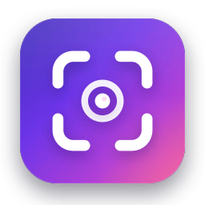
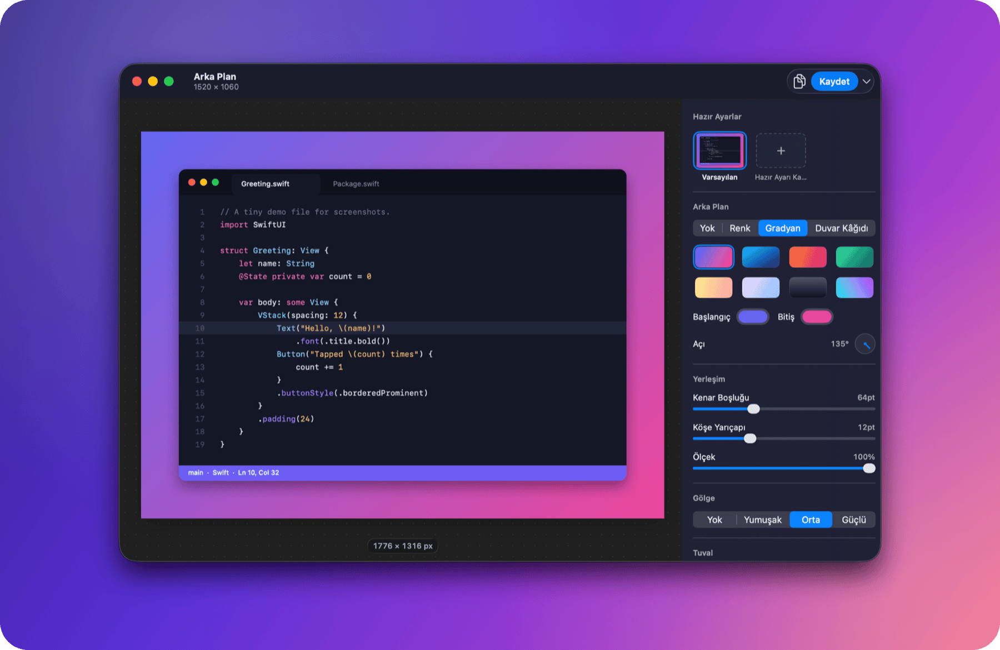
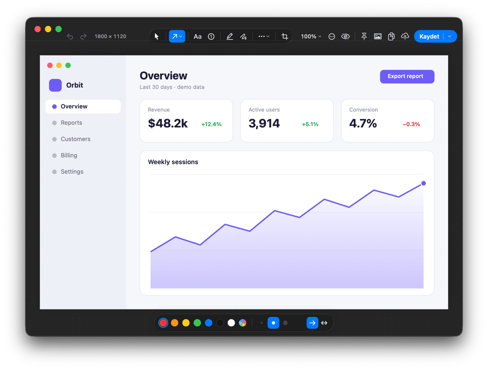
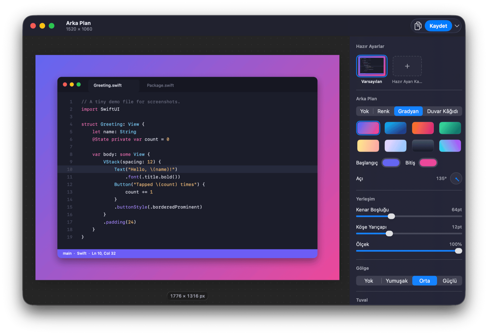
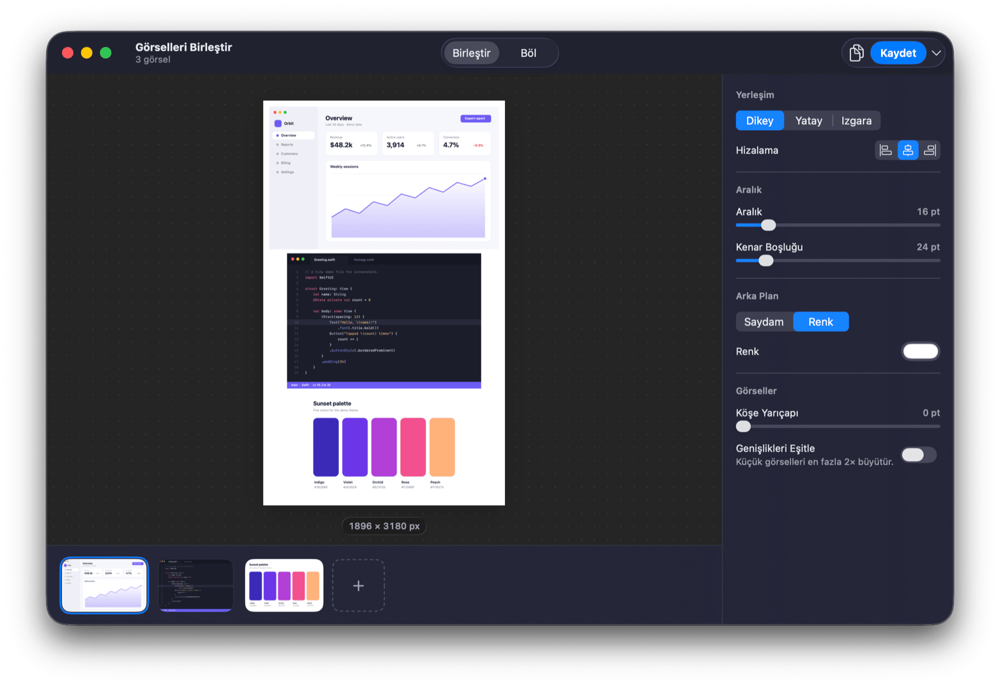
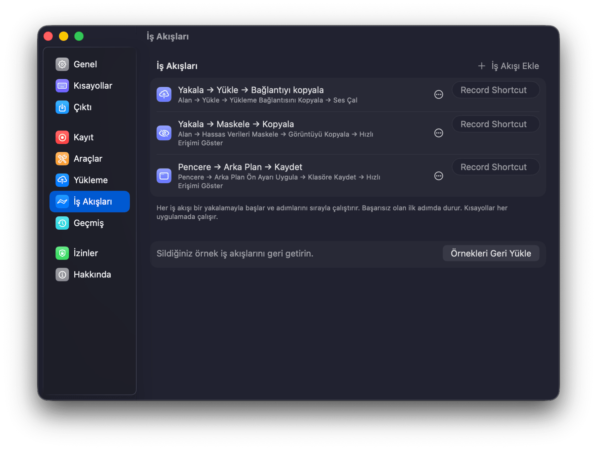
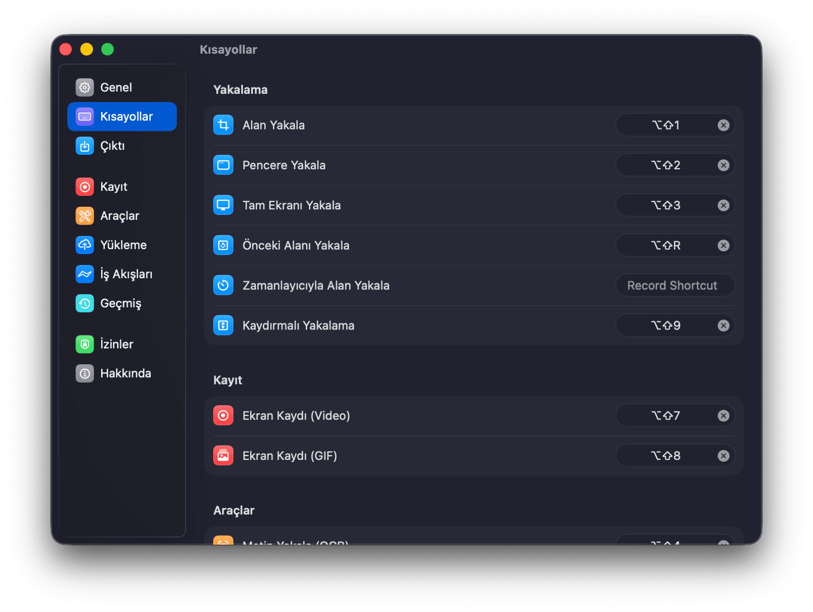
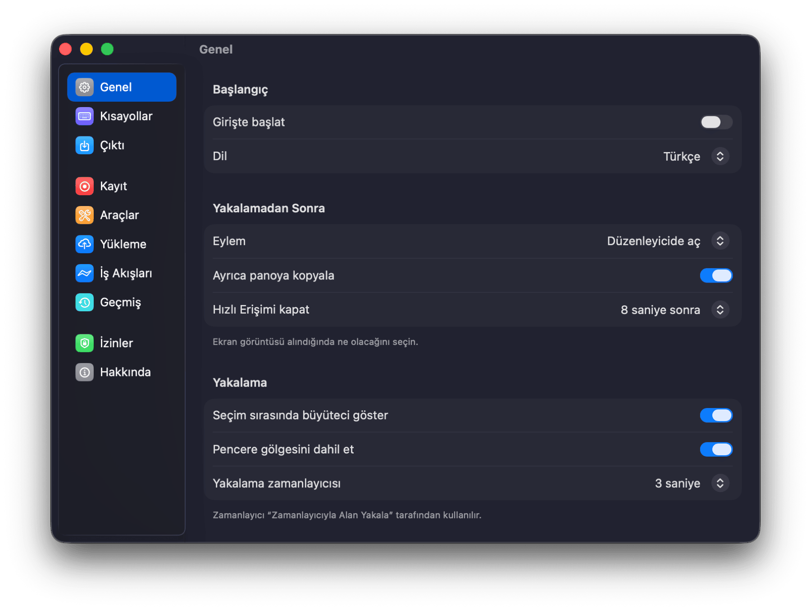

<p align="center">
  
</p>

<h1 align="center">ScreenShotForMac</h1>

<p align="center">
  <b>Yakala, işaretle, kaydet ve paylaş. macOS için yerel, gizliliğe saygılı ve açık kaynak tek araç seti.</b><br>
  Ekran görüntüleri, ekran kayıtları, piksel araçları ve işaretleme düzenleyicisi, bir kısayol uzağında.
</p>

<p align="center">
  <a href="https://github.com/atak946/ScreenShotForMac/releases/latest"></a>
  
  
  <a href="LICENSE"></a>
  <a href="https://github.com/atak946/ScreenShotForMac/actions/workflows/ci.yml"></a>
  <a href="https://github.com/atak946/ScreenShotForMac/releases"></a>
</p>

<p align="center">
  <a href="https://github.com/atak946/ScreenShotForMac/releases/latest">
    
  </a>
</p>

<p align="center">
  
</p>

<p align="center">
  <a href="README.md">English</a> · <b>Türkçe</b>
</p>

---

## ✨ Bir bakışta

ScreenShotForMac menü çubuğunda yaşar. Bir kısayola bas; bir alanı, bir pencereyi ya da tüm ekranı seç, sonra
ne olacağına karar ver: kopyala, kaydet, işaretle, sabitle, yükle ya da bir iş akışı çalıştır. Her şey Mac'inde
çalışır. Hesap yok, telemetri yok.

<table>
  <tr>
    <td width="50%" valign="top">
      
      <h3>✏️ İşaretleme düzenleyicisi</h3>
      Ok, şekil, metin, vurgulayıcı, bulanıklaştırma, pikselleştirme, spot ışığı, büyüteç, sayaç ve akıllı silgi.
      Her aracın tek harflik bir kısayolu var.
    </td>
    <td width="50%" valign="top">
      
      <h3>🎨 Arka Plan</h3>
      Her yakalamayı gradyan, düz renk ya da bulanıklaştırılmış duvar kâğıdı üzerine koy; kenar boşluğu,
      yuvarlak köşe ve gölge ekle. Görünümü hazır ayar olarak sakla.
    </td>
  </tr>
  <tr>
    <td width="50%" valign="top">
      
      <h3>🧩 Birleştir ve böl</h3>
      Birden çok görseli dikey, yatay ya da ızgara halinde birleştir veya uzun bir görseli parçalara böl.
    </td>
    <td width="50%" valign="top">
      
      <h3>⚡ İş akışları</h3>
      Yakalamanın ardından adımları zincirle: maskele, arka plan ekle, kaydet, yükle, bağlantıyı kopyala,
      sabitle ya da bir uygulamada aç. Her iş akışına kendi genel kısayolunu ver.
    </td>
  </tr>
</table>

## 🧰 Özellikler

### 📸 Yakalama
- Canlı boyut, koordinat ve piksel büyüteciyle alan seçimi
- Üzerine gelince vurgulanan, isteğe bağlı gölgeli pencere yakalama; başka pencerelerin arkasında kalanlar dahil
- Etkin ekranın ya da tüm ekranların tam ekran görüntüsü, farklı DPI'lı kurulumlarda da doğru
- Erişilebilirlik API'siyle arayüz öğelerine yapışma
- Sayfayı kendisi kaydırıp kareleri birleştiren kaydırmalı yakalama
- Zamanlayıcıyla yakalama ve önceki alanı yeniden yakalama
- Seçim sırasında donan ekran; menüler ve animasyonlar yerinde kalır
- Seçimin üzerinde eylem çubuğu: ekran görüntüsü, kayıt, kaydırma, OCR

### 🎬 Ekran kaydı
- Bir alanın, pencerenin ya da tüm ekranın video (MP4/MOV) ve GIF kaydı
- Sistem sesi ve mikrofon, ikisi de isteğe bağlı
- Tıklama vurgusu, tuş vuruşu gösterimi, kamera balonu ve imleç görünürlüğü ayarları
- Duraklat, devam et ve iptal; geçen süre göstergesiyle
- Yerleşik video düzenleyicide kırpma ve sesi kapatma

### ✏️ Düzenleyici
- Ok (tek ya da çift uçlu), çizgi, dikdörtgen, elips, metin ve yumuşatmalı kalem
- Vurgulayıcı, bulanıklaştırma, pikselleştirme, spot ışığı ve büyüteç
- Bir bölgeyi çevresindeki arka plan rengiyle dolduran akıllı silgi
- Kendiliğinden artan adım sayaçları ve görsel katmanları
- En-boy oranı hazır ayarlarıyla kırpma, döndürme ve çevirme
- Seçme, taşıma, boyutlandırma, sıralama ve kopyala/yapıştır; sınırsız geri al ve yinele
- Yakınlaştırma, kaydırma ve piksel ızgarası

### 🔬 Araçlar
- HEX, RGB, HSL, SwiftUI ve NSColor çıktılı renk seçici
- Kenar algılamalı piksel cetveli, iki nokta arası ve alan ölçümü
- Seçilebilir dillerle cihaz üzerinde metin tanıma (OCR)
- QR kod ve barkod okuma
- Diğer pencerelerin üzerinde duran, saydamlığı, tıklama geçirgenliği, döndürme ve yakınlaştırması olan sabitlenmiş görüntüler

### 📤 Paylaşım
- Panoya kopyalama; kalite ayarıyla PNG, JPEG ya da HEIC olarak kaydetme
- `{date}_{time}_{counter}` gibi dosya adı şablonları ve isteğe bağlı Retina'dan 1x'e küçültme
- Hızlı Erişim önizlemesinden herhangi bir uygulamaya sürükle-bırak
- S3 uyumlu depolamaya (AWS S3, Cloudflare R2, MinIO, Backblaze B2) ya da özel bir HTTP uç noktasına yükleme;
  kimlik bilgileri Anahtar Zinciri'nde saklanır
- OCR metniyle aranabilen ve kendiliğinden temizlenen yakalama geçmişi

## ⌨️ Klavye kısayolları

Varsayılan genel kısayollar. Hepsini **Ayarlar › Kısayollar** bölümünden değiştirebilirsin.

| Kısayol | Eylem |
|---|---|
| <kbd>⌥</kbd><kbd>⇧</kbd><kbd>1</kbd> | Alan yakala |
| <kbd>⌥</kbd><kbd>⇧</kbd><kbd>2</kbd> | Pencere yakala |
| <kbd>⌥</kbd><kbd>⇧</kbd><kbd>3</kbd> | Tam ekranı yakala |
| <kbd>⌥</kbd><kbd>⇧</kbd><kbd>4</kbd> | Metin yakala (OCR) |
| <kbd>⌥</kbd><kbd>⇧</kbd><kbd>5</kbd> | Renk seç |
| <kbd>⌥</kbd><kbd>⇧</kbd><kbd>6</kbd> | QR kod tara |
| <kbd>⌥</kbd><kbd>⇧</kbd><kbd>7</kbd> | Ekran kaydı (video) |
| <kbd>⌥</kbd><kbd>⇧</kbd><kbd>8</kbd> | Ekran kaydı (GIF) |
| <kbd>⌥</kbd><kbd>⇧</kbd><kbd>9</kbd> | Kaydırmalı yakalama |
| <kbd>⌥</kbd><kbd>⇧</kbd><kbd>0</kbd> | Ölç (piksel cetveli) |
| <kbd>⌥</kbd><kbd>⇧</kbd><kbd>R</kbd> | Önceki alanı yakala |
| <kbd>⌥</kbd><kbd>⇧</kbd><kbd>V</kbd> | Panodakini düzenleyicide aç |
| *(atanmamış)* | Zamanlayıcıyla alan yakala · Panodaki görseli sabitle · Yakalama geçmişi |

Düzenleyicinin kendi tek tuşluk araç kısayolları var: `V` seç, `A` ok, `L` çizgi, `R` dikdörtgen,
`O` elips, `T` metin, `H` vurgula, `B` bulanıklaştır, `P` pikselleştir, `S` spot ışığı, `M` büyüteç,
`E` akıllı silgi, `N` sayaç, `D` kalem, `C` kırp.

<p align="center">
  
  
</p>

## 📦 Kurulum

1. En son **ScreenShotForMac-x.y.z.dmg** dosyasını
   [Releases](https://github.com/atak946/ScreenShotForMac/releases/latest) sayfasından indir.
2. Aç ve **ScreenShotForMac**'i **Uygulamalar** klasörüne sürükle.
3. Başlat. Uygulama menü çubuğunda yaşar, Dock'ta simgesi yoktur. Kısa bir tanıtım Ekran Kaydı iznini ister.

Sürümler Developer ID ile imzalanır ve Apple tarafından onaylanır (notarize), bu yüzden Gatekeeper onları kabul
eder. macOS yalnızca ilk açılışta her zamanki "internetten indirildi" onayını gösterir.

**Gereksinimler:** macOS 14 Sonoma veya üstü, Apple Silicon ya da Intel. Uygulama Türkçe ve İngilizce
kullanılabilir.

### 🔐 İzinler

| İzin | Neden gerekli | Ne zaman istenir |
|---|---|---|
| **Ekran Kaydı** | macOS, ekran görüntüsü, kayıt, OCR, renk seçimi ve ölçüm için ekran piksellerini okumaya bu izinle olanak verir. | İlk açılışta, tanıtım sırasında |
| **Erişilebilirlik** | Arayüz öğelerine yapışma, kaydırmalı yakalamada otomatik kaydırma ve kayıtlarda tıklama vurgusu. | Bu izni isteyen bir özelliği ilk kullandığında |
| **Mikrofon** | Ekran kaydına sesini eklemek. | Yalnızca mikrofon kaydını açtığında |
| **Kamera** | Ekran kayıtlarındaki kamera balonu. | Yalnızca kamera balonunu açtığında |

İzinleri **Sistem Ayarları › Gizlilik ve Güvenlik** ya da uygulamadaki **Ayarlar › İzinler** bölümünden
görebilirsin. Uygulama sandbox içinde çalışmaz, çünkü App Sandbox yukarıdaki Erişilebilirlik ve olay yakalama
(event tap) özelliklerini engeller.

## 🔄 Otomatik güncellemeler

ScreenShotForMac günde bir kez [Sparkle](https://sparkle-project.org) ile güncelleme denetler. Güncelleme akışı
ve DMG dosyaları bu projenin GitHub Releases sayfasında yayımlanır; her güncelleme kurulmadan önce EdDSA
imzasıyla doğrulanır. Menü çubuğu simgesinden **Güncellemeleri Denetle…** ile elle de denetleyebilirsin.

## 🤖 Otomasyon

### URL şeması

```text
ssfm://capture?mode=area|window|fullscreen|scrolling|last&action=copy|save|edit|upload|pin&delay=N
ssfm://record?format=mp4|gif           # kaydı başlat ya da durdur
ssfm://workflow?name=<ad>              # ya da ?id=<uuid>
ssfm://open?path=<dosya>               # görseli düzenleyicide aç
ssfm://backdrop?path=<dosya>           # görseli Arka Plan'da aç
ssfm://combine?path=<a>&path=<b>       # görselleri bu sırayla Birleştir'de aç
ssfm://ocr                             # metin yakala
ssfm://color                           # renk seç
ssfm://qr                              # QR kod tara
ssfm://measure                         # piksel cetveli
ssfm://history                         # geçmiş penceresini aç
ssfm://settings                        # Ayarlar'ı aç
```

`mode` verilmezse `area` kullanılır; `action` yoksa "yakalamadan sonra" ayarı geçerli olur. Dosya yolları
mutlak olmalıdır (`~` açılır). Terminalden: `open "ssfm://capture?mode=window&action=copy"`. Aynı eylemler
Kestirmeler (Shortcuts) uygulamasında da var.

### Komut satırı (CLI)

`ssfm` komut satırı aracı (`Sources/ShotCLI`) bu URL'leri senin yerine oluşturur:

```sh
scripts/install-cli.sh                 # release derlemesi yapar, /usr/local/bin'e kurar (gerekirse sudo)
scripts/install-cli.sh --prefix ~/bin  # ya da yazabildiğin herhangi bir klasöre, sudo gerekmez
scripts/install-cli.sh --link          # kopyalamak yerine derleme çıktısına sembolik bağlantı
```

```sh
ssfm capture --copy
ssfm capture window --save --delay 3
ssfm record gif
ssfm workflow "Yakala → Yükle → Bağlantıyı kopyala"
ssfm open ~/Desktop/shot.png
ssfm --help
```

Uygulamanın kurulu olması gerekir (`ssfm://` URL'lerini uygulama işler); CLI yalnızca komutları iletir.

## 🛠️ Kaynaktan derleme

Derlemek için Xcode 16 veya üstü (Swift 6) ve [XcodeGen](https://github.com/yonaskolb/XcodeGen) gerekir.

```sh
brew install xcodegen

git clone https://github.com/atak946/ScreenShotForMac.git
cd ScreenShotForMac

# İmzalama: Apple Developer Team ID'ni yerel, git'e girmeyen bir yapılandırmaya yaz
cp Config/Local.xcconfig.example Config/Local.xcconfig
# Config/Local.xcconfig dosyasını düzenle -> DEVELOPMENT_TEAM = <team id>

xcodegen generate
xcodebuild -project ScreenShotForMac.xcodeproj \
  -scheme ScreenShotForMac -configuration Debug \
  -derivedDataPath DerivedData build
```

İmzalama kimliği olmadan derlemek için (CI ya da hızlı bir derleme denetimi) `CODE_SIGNING_ALLOWED=NO` ekle.
İmzasız bir derleme Ekran Kaydı iznini açılışlar arasında koruyamaz; günlük denemeler için imzalı derleme kullan.
`.xcodeproj` üretilen bir dosyadır: proje dosyasını değil `project.yml`'ı değiştir.

`ShotKit` Swift paketi tek başına da `swift build` ve `swift test` ile derlenip test edilebilir.

<details>
<summary><b>Mimari</b></summary>

Uygulama hedefi (`App/`) ince bir kabuktur: uygulama temsilcisi, menü çubuğu, URL yönlendirme ve modülleri
birbirine bağlayan bir koordinatör. Özellikler `ShotKit` Swift paketinde yaşar. Her özellik modülü yalnızca
`ShotCore`'a bağımlıdır; modüller orada tanımlanan protokollerle haberleşir.

| Modül | Sorumluluk |
|---|---|
| `ShotCore` | Ortak modeller, `AppCommand`, ayarlar, loglama, servis protokolleri, tasarım değerleri |
| `ShotCapture` | Alan, pencere ve tam ekran yakalama, seçim katmanı, büyüteç, öğeye yapışma |
| `ShotRecording` | Video ve GIF ekran kaydı, ses, tıklama vurgusu, kayıt kontrolleri |
| `ShotScrolling` | Kaydırmalı yakalama: otomatik kaydırma, kare alma, kayma tahmini, birleştirme |
| `ShotEditor` | İşaretleme düzenleyicisi: tuval, araçlar, çizim, geri alma, kırpma ve dönüştürme |
| `ShotTools` | OCR, renk seçici, barkod ve QR algılama |
| `ShotMeasure` | Piksel cetveli ve kenar algılayan ölçüm katmanı |
| `ShotBackdrop` | Arka planlar, kenar boşluğu, gölgeler ve stil hazır ayarları |
| `ShotPin` | Ekranda duran sabitlenmiş görseller |
| `ShotExport` | Kodlama, kaydetme, dosya adı şablonları, Hızlı Erişim önizlemesi, sürükleyerek dışa aktarma |
| `ShotHistory` | Yakalama geçmişi, küçük resimler, OCR araması, saklama süresi |
| `ShotUpload` | Yükleme hedefleri (S3 uyumlu, özel HTTP), Anahtar Zinciri depolama |
| `ShotWorkflow` | Kısayola bağlı iş akışları, URL otomasyonu ve App Intents |
| `ShotVideoEditor` | Kayıtlar için kırpma ve basit düzenlemeler |
| `ShotCombine` | Görselleri birleştirme ve bölme |
| `ShotSettings` | Ayarlar penceresi, tanıtım, genel kısayollar, girişte başlatma |
| `ShotCLI` | `ssfm` komut satırı aracı |

</details>

<details>
<summary><b>Yerelleştirme</b></summary>

Metinler String Catalog dosyalarında (`Localizable.xcstrings`) durur: her modülün `Resources/` klasöründe bir
tane ve `App/Resources/` içinde bir tane. Yeni bir dil eklemek için:

1. Projeyi Xcode'da aç, bir `Localizable.xcstrings` dosyası seç ve dili **+** düğmesiyle ekle. Bunu her
   modülün kataloğu için tekrarla.
2. Girdileri çevir. Xcode eksik çevirileri işaretler.
3. Dil kodunu `project.yml` içindeki `CFBundleLocalizations` listesine ekle.
4. Dil seçicide görünmesi için `Sources/ShotCore/AppSettings.swift` içindeki `AppLanguage`'a bir case ekle.
5. `xcodegen generate` çalıştır ve arayüzde kesilen metin var mı bak.

Kodla ilgili yerelleştirme kuralları için [CONTRIBUTING.md](CONTRIBUTING.md#localization) dosyasına bak.

</details>

<details>
<summary><b>README görselleri nasıl üretiliyor</b></summary>

İkon ve tüm ekran görüntüleri `scripts/design/` altındaki betiklerle üretilir ve yalnızca yapay demo içerik
gösterir:

```sh
swift scripts/design/make-icon.swift          # uygulama ikonu + docs/images/icon.png
swift scripts/design/make-demo.swift          # scripts/design/demo altındaki demo görseller
scripts/design/capture-screenshots.sh         # uygulama pencereleri, İngilizce ve Türkçe
swift scripts/design/make-hero.swift          # Arka Plan görüntüsünden kapak görseli
```

</details>

## 🛡️ Gizlilik

- **Telemetri yok.** Analitik, çökme raporu ya da izleme yok.
- **Cihaz üzerinde.** OCR, barkod algılama ve görüntü işleme Mac'inde, Apple'ın Vision ve Core Image
  çerçeveleriyle yapılır.
- **Yerel geçmiş.** Geçmiş Mac'inde saklanır, OCR metniyle aranabilir ve seçtiğin saklama süresinden sonra
  kendiliğinden silinir.
- **Ağ yalnızca gerektiğinde:** kendin kurduğun hedeflere yüklemeler ve yalnızca bu projenin güncelleme
  akışını GitHub Releases'tan indiren günlük güncelleme denetimi.

Ayrıntılar [PRIVACY.md](PRIVACY.md) dosyasında.

## 🤝 Katkı

Hata bildirimleri ve pull request'ler memnuniyetle karşılanır. Pull request açmadan önce
[CONTRIBUTING.md](CONTRIBUTING.md) dosyasını oku. Değişiklikler [CHANGELOG.md](CHANGELOG.md) dosyasında
listelenir; sürüm yayımlama adımları [docs/RELEASING.md](docs/RELEASING.md) dosyasında anlatılır.

## 📄 Lisans

ScreenShotForMac [MIT Lisansı](LICENSE) ile yayımlanır.

## 🙏 Emeği geçenler

- **Geliştirici:** Murat ATAK ([@atak946](https://github.com/atak946))
- Kaydedilebilir genel kısayollar için [KeyboardShortcuts](https://github.com/sindresorhus/KeyboardShortcuts) (MIT)
- Otomatik güncellemeler için [Sparkle](https://sparkle-project.org) (MIT)

Mac'teki pek çok güzel ekran görüntüsü aracından ilham alındı; yerel, gizliliğe saygılı ve açık kaynak olacak
şekilde yazıldı.
